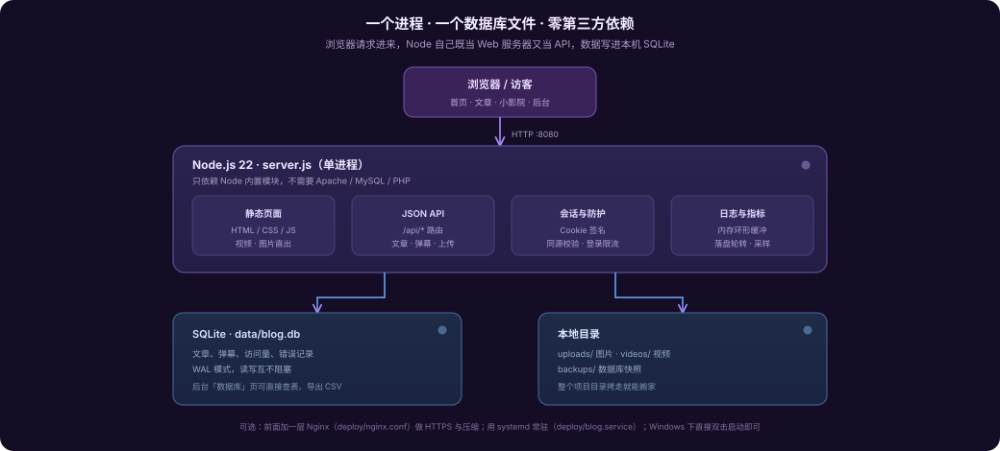

<div align="center">

</div>

<h1 align="center">🎀 Hi～我是「模糊二维码」的单机版 ( ˶ˆ ᗜ ˆ˵ ) ♡</h1>

<h3 align="center">🌸 一整个博客，被塞进一个 Node 进程里 ૮₍ ˃ ⤙ ˂ ₎ა 🌸</h3>

<p align="center">
能看文章 · 能刷弹幕 · 能放视频 · 能写后台<br>
而你要做的，只是敲一行 <code>npm start</code> 而已啦～
</p>

<p align="center">
  
  
  
  
  
  
</p>

<p align="center">⋆｡°✩ ♡ ✩°｡⋆ ✿ ⋆｡°✩ ♡ ✩°｡⋆</p>

---

## 🎀 先认识一下人家嘛 (๑>ᴗ<๑)

我是这个博客的**单机版**——不用 Apache、不用 MySQL、不用 PHP、不用 Docker，甚至连 `npm install` 都不用跑。

装个 Node.js，把我下载下来，`npm start`，我就醒过来了 (｡•̀ᴗ-)✧

| 小标签 | 人家的答案 |
| --- | --- |
| 🌸 我叫什么 | 模糊二维码 · 博客单机版（Windows / macOS 都能住） |
| 🍬 我吃什么 | Node.js ≥ 22.5，别的什么都不要 |
| 🧸 我住在哪 | 你家电脑的一个文件夹里，数据全在 `data/blog.db` 一个文件中 |
| 🎀 我多重 | 0 个第三方依赖，`package.json` 里干干净净 |
| 💗 我适合谁 | 想自己写点东西、又不想折腾服务器的小可爱 |

<p align="center">🌸 ⋆｡°✩ 💗 ✩°｡⋆ 🌸</p>

## 🍭 目录 · 想先看哪一节呢 ( ˘ ³˘)♥

| 章节 | 里面写了什么 |
| :---: | --- |
| ❶ | 30 秒就能跑起来 — 真的只要 30 秒 |
| ❷ | 它长什么样呀 — 架构图 + 一句话原理 |
| ❸ | 技术栈全都交代了 — 五组表格，一行都不藏 |
| ❹ | 第一次配置 — 改三行 `.env` 就够 |
| ❺ | 部署到不同地方 — 本机 / Ubuntu 一键 / 手动 / Git 更新 |
| ❻ | 备份与恢复 — 别等丢了才想起我 |
| ❼ | 文件都放在哪 — 目录树 |
| ❽ | 后台能玩什么 — 九个页面 |
| ❾ | 小问题急救箱 — 七个常见毛病 |
| ❿ | 姊妹仓库 — 想要服务器版去隔壁 |

---

## 🍬 ❶ 30 秒就能跑起来 ٩(ˊᗜˋ*)و

<p align="center"><sub>♡ 乖乖跟着复制粘贴，一分钟都用不到 ♡</sub></p>

```bash
git clone https://github.com/ipc-mdd-gl3-1545/blur-qr-blog-Windows.git
cd blur-qr-blog-Windows
npm start          # 等价于 node server.js，没有任何 npm 包要装
```

然后打开浏览器，就见到我啦：

| 页面 | 地址 | 心情 |
| --- | --- | --- |
| 博客首页 | <http://127.0.0.1:8080/> | 有人来看我了！(๑>ᴗ<๑) |
| 管理后台 | <http://127.0.0.1:8080/manage> | 这里是我的小书桌 ✧ |

> [!IMPORTANT]
> 🎀 **第一次启动我会偷偷做三件事**：建 `data/blog.db`、建 `videos/` 目录、
> **生成一个随机的后台密码并直接打印在控制台**——只显示这一次哦，记得抄下来 ฅ(•ﻌ•)ฅ
>
> 忘了也没关系，第 ❹ 节有「重新生成密码」的救命方法。

> [!TIP]
> 🍰 `.env` 可以完全不建，全部走默认值；
> 想定制（改后台路径、固定密码、换端口）就 `cp .env.example .env`，然后看第 ❹ 节～
>
> 需要什么？**只要 Node.js ≥ 22.5**（推荐 22 LTS 或 24 LTS）。别的真的什么都不用装 (´｡• ᵕ •｡`)

<p align="center">･ﾟ✧ ♡ ✧ﾟ･</p>

## 🌸 ❷ 它长什么样呀 (◕‿◕✿)

<p align="center"><sub>♡ 一张图讲完，不绕弯子 ♡</sub></p>

```
🌐 浏览器 · 访客 / 你自己
    │  HTTP :8080
    ▼
📦 server.js · Node.js 22（一个进程，零依赖）
    ├─ 静态页面 · index / article / admin
    ├─ JSON API · 文章 / 弹幕 / 视频 / 统计
    ├─ 会话防护 · scrypt 哈希 + HMAC 签名
    └─ 日志指标 · gzip / 日志轮转 / healthz
         │
         ├──▶ 🗄 SQLite · data/blog.db
         │        文章 / 弹幕 / 访问量 / 错误记录（一个文件 = 全部数据）
         ├──▶ 🖼 uploads/ + videos/    图片与视频原文件
         └──▶ 💾 backups/              VACUUM INTO 生成的库快照
```

<details open>
<summary><b>🍬 点开看完整架构图（矢量图，缩到手机上也能看清）</b></summary>

<div align="center">

</div>

</details>

一句话总结：**浏览器进来，Node 既当 Web 服务器又当 API，数据写进本机一个 SQLite 文件里。**

没有反向代理也能跑哦～前面加一层 Nginx 纯粹是为了 HTTPS 和更好看的域名 (｡•̀ᴗ-)✧

<p align="center">･ﾟ✧ ♡ ✧ﾟ･</p>

## 🧸 ❸ 技术栈，全都在这了 (๑˃ᴗ˂)ﻭ

<p align="center"><sub>♡ 没有偷偷藏东西，下面每一行都在真实地跑着 ♡</sub></p>

### 🍓 3.1 运行时与后端

| 技术 | 版本 / 形态 | 在这个项目里干什么 |
| --- | --- | --- |
| **Node.js** | ≥ 22.5（推荐 22 LTS / 24 LTS） | 唯一的运行时，启动时做版本检查，低了直接提示怎么装 |
| **`node:http`** | 内置模块 | 自己写 HTTP 服务与路由，不引 Express / Fastify |
| **`node:sqlite`** | 内置驱动（Node 22.5 起） | 直接操作 SQLite，**不需要 `npm install sqlite3`** |
| **`node:crypto`** | 内置模块 | scrypt 密码哈希、HMAC-SHA256 签名、`timingSafeEqual` 比对 |
| **`node:zlib`** | 内置模块 | 对 HTML / CSS / JS / JSON 做 gzip，省流量 |
| **`node:stream` + `pipeline`** | 内置模块 | 视频上传、下载走流，几百 MB 也不吃内存 |
| **multipart 解析器** | 手写（约 100 行） | 处理表单上传，不依赖 busboy / formidable |
| **依赖数量** | **0 个** | `package.json` 里没有 `dependencies`，clone 完不用 `npm install` |

### 🍮 3.2 数据与存储

| 技术 | 形态 | 说明 |
| --- | --- | --- |
| **SQLite** | 单文件 `data/blog.db` | 文章、弹幕、访问量、错误记录全在里面，拷走一个文件就是全部数据 |
| **WAL 模式** | `journal_mode=WAL` | 读写互不阻塞，后台写文章时前台照样能刷弹幕 |
| **本地文件目录** | `uploads/` `videos/` `backups/` | 图片、视频、数据库快照，全部是可读可拷的普通文件 |
| **`VACUUM INTO`** | 备份快照 | 服务运行中也能生成一致的库快照，不用停服 |
| **JSON 导入导出** | 后台功能 | 文章整包带走，换机器 / 换版本都不丢 |

### 🍡 3.3 前端

| 技术 | 说明 |
| --- | --- |
| **原生 HTML / CSS / JavaScript** | 没有 React、没有 Vue、没有构建步骤，改完刷新就生效 |
| **CSS 变量 + 深色主题** | 粉紫渐变、玻璃拟态卡片，纯 CSS 手写 |
| **Canvas 弹幕** | 视频上飘的弹幕是自己画的，带 id 去重，不会一条变两条 |
| **Markdown 子集渲染** | 前端 + 后端各有一份轻量渲染，文章支持标题 / 列表 / 代码 / 图片 / 引用 |
| **响应式布局** | 手机、平板、桌面三档断点，后台侧栏在窄屏自动折叠 |
| **视频背景 + 小影院** | 首页背景视频、文章页视频播放、弹幕同屏 |

前端一共这些页面：`index.html`（首页）、`article.html`（文章详情）、`admin.html`（后台），
外加六个方向页 `ai-agent / backend / database / frontend / network / sre`。

### 🍬 3.4 安全（这块人家很认真 ( • ̀ω•́ )✧）

| 技术 | 说明 |
| --- | --- |
| **scrypt 密码哈希** | `N=16384, r=8, p=1, salt 16 字节`，密码不落明文 |
| **HMAC-SHA256 会话签名** | Cookie 内容被改一个字节都验不过 |
| **`HttpOnly` + `SameSite=Strict`** | JS 读不到会话，跨站请求自动不带 Cookie |
| **同源校验** | 比对 `Origin` 与 `Host`，与 SameSite 双重挡 CSRF |
| **`timingSafeEqual`** | 哈希 / 签名比对不用 `===`，避免时序侧信道 |
| **登录限流** | 10 分钟内失败 8 次锁定 15 分钟（`LOGIN_MAX_TRIES` 可调） |
| **后台路径隐藏** | 首页没有任何后台入口，只有知道 `ADMIN_PATH` 才能打开登录页 |
| **上传白名单** | 图片按 MIME + 扩展名双校验，视频只认白名单后缀 |

### 🎀 3.5 部署与运维

| 技术 | 说明 |
| --- | --- |
| **systemd** | `deploy/blog.service`：开机自启、崩溃 3 秒拉起、日志进 journald |
| **systemd 沙箱** | `ProtectSystem=strict`、`NoNewPrivileges`、`PrivateTmp`、`MemoryMax=512M` |
| **Nginx（可选）** | `deploy/nginx.conf`：反代 + 真实 IP + 限流 20r/s，gzip 交给 Node 做 |
| **一键脚本** | `deploy/install.sh`：装 Node → 建 `blog` 用户 → 生成 `.env` → 起服务 |
| **Git 部署脚本** | `deploy/git-init.sh`：服务器上从仓库同步，`.env` / `data` / `uploads` 不覆盖 |
| **内网穿透脚本** | `deploy/tunnel.sh`：本机跑着、外面也想看的场景 |
| **`tools/hash-password.js`** | 命令行生成密码哈希，忘记密码时救命 |
| **`tools/backup.js`** | 命令行备份，配合 cron 做定时 |
| **`tools/clean-uploads.js`** | 清掉没被任何文章引用的孤儿图片 |
| **日志轮转** | 超过 5MB 自动切成 `blog.log.1`，只留一份旧的 |
| **健康检查** | `GET /healthz` 返回 `{ok, uptime, node, time}`，给监控用 |

<p align="center">･ﾟ✧ ♡ ✧ﾟ･</p>

## 🍰 ❹ 首次配置（三分钟，真的三分钟 ꒰ঌ( ˊᵕˋ )໒꒱）

### 4.1 认识 `.env`

```bash
cp .env.example .env      # 首次运行 server.js 也会自动帮你生成
```

只改这三行就够用啦：

```ini
# 后台地址：改成一串别人猜不到的，比如 /studio-7k2p
ADMIN_PATH=/manage

# 后台密码哈希，用下面的命令生成
ADMIN_PASSWORD_HASH=scrypt$16384$8$1$....

# 想让局域网其他设备访问，就监听 0.0.0.0；只自己用保持 127.0.0.1
HOST=127.0.0.1
```

### 4.2 生成密码哈希

```bash
node tools/hash-password.js '你的新密码'
# 输出：scrypt$16384$8$1$xxxx$yyyy  ← 整行贴到 ADMIN_PASSWORD_HASH=
```

> [!TIP]
> 🍬 也可以在后台「设置」页直接改密码，改完立即生效，不用重启哦 (｡•̀ᴗ-)✧

### 4.3 改完重启

```bash
# 前台运行的，Ctrl+C 再 npm start
# systemd 托管的：
sudo systemctl restart blog
sudo systemctl status blog --no-pager
curl -s http://127.0.0.1:8080/healthz
```

<p align="center">･ﾟ✧ ♡ ✧ﾟ･</p>

## ☁️ ❺ 部署到不同地方 (๑•̀ㅂ•́)و✧

<p align="center"><sub>♡ 四种方式，挑最顺手的那一种就好啦 ♡</sub></p>

### 5.1 Windows / macOS：在自己电脑上养着玩

```bash
git clone https://github.com/ipc-mdd-gl3-1545/blur-qr-blog-Windows.git
cd blur-qr-blog-Windows
npm start
```

打开 <http://127.0.0.1:8080/manage> → 输入密码 → 开始写第一篇 ✧

- 想让手机在同一 WiFi 下也能看：`.env` 里把 `HOST=127.0.0.1` 改成 `HOST=0.0.0.0`，然后访问 `http://你的内网IP:8080`
- 关掉黑窗口我就睡着啦，想常驻就装成服务（Windows 用 NSSM，macOS 用 launchd，脚本不提供，属于系统差异哦）
- 数据都在项目目录里：`data/`、`uploads/`、`videos/`，**整个文件夹拷走就是搬家** ٩(๑˃̵ᴗ˂̵)۶

### 5.2 Ubuntu 服务器：一条命令装好

```bash
# 1. 把代码放到服务器（git 或 scp 压缩包都行）
sudo git clone https://github.com/ipc-mdd-gl3-1545/blur-qr-blog-Windows.git /root/blog-src
cd /root/blog-src

# 2. 一键安装
sudo bash deploy/install.sh
```

脚本会乖乖依次做完这些：

1. 检查 Node 版本，不够就装 22 LTS（也可以用本地 tar.gz 离线装）
2. 建系统用户 `blog`，把代码同步到 `/opt/blog`
3. 生成 `.env`：随机后台路径、随机密码哈希、随机会话密钥
4. 装 systemd 单元，开机自启 + 崩溃拉起
5. 如果给了域名，顺手写 Nginx 反代并 reload

三种调用方式，挑一个喜欢的：

```bash
sudo bash deploy/install.sh                 # 只听 127.0.0.1:8080（推荐配 Nginx）
sudo bash deploy/install.sh --public        # 听 0.0.0.0:8080，直接 IP 访问，自动放行防火墙
sudo bash deploy/install.sh blog.example.com  # 配 Nginx 反代 + 域名 + HTTPS
```

> [!CAUTION]
> 🎀 装完脚本会把**后台地址和初始密码**打印出来（大概长这样），一定抄下来，只显示这一次！
>
> ```
>   后台地址      http://你的IP/manage-x7k2p9
>   网站地址      http://你的IP:8080
>   后台密码      A7f9Kd2mQx          ← 只显示这一次，立刻记录
> ```

常用运维命令（顺手存进备忘录吧 (´｡•ω•｡`)）：

```bash
sudo systemctl status blog       # 看状态
sudo systemctl restart blog      # 重启
journalctl -u blog -f            # 追日志
journalctl -u blog -n 200        # 最近 200 行
```

### 5.3 手动部署（已经装了 Nginx，想自己控制）

```bash
# 1. 建用户和目录
sudo useradd -r -s /usr/sbin/nologin blog
sudo mkdir -p /opt/blog && sudo chown blog:blog /opt/blog

# 2. 放代码、建数据目录
sudo cp -a . /opt/blog/
sudo -u blog mkdir -p /opt/blog/data /opt/blog/uploads /opt/blog/videos /opt/blog/data/backups

# 3. 配置
cd /opt/blog && sudo -u blog cp .env.example .env
sudo -u blog node tools/hash-password.js '你的密码'    # 贴进 .env
sudoedit .env                                          # 改 ADMIN_PATH / HASH / HOST

# 4. systemd
sudo cp deploy/blog.service /etc/systemd/system/
sudo systemctl daemon-reload && sudo systemctl enable --now blog

# 5. Nginx（可选）
sudo cp deploy/nginx.conf /etc/nginx/sites-available/blog
sudo sed -i 's/__DOMAIN__/blog.example.com/g' /etc/nginx/sites-available/blog
sudo ln -sf /etc/nginx/sites-available/blog /etc/nginx/sites-enabled/
sudo nginx -t && sudo systemctl reload nginx
```

### 5.4 从 Git 更新（服务器上）

```bash
sudo bash /opt/blog/deploy/git-init.sh
```

它会 clone / 更新到 `/opt/blog-src`，只同步受版本控制的文件，
**`.env`、`data/`、`uploads/`、`videos/` 一律不碰**，所以文章和密码都安全 (๑˘︶˘๑)

### 5.5 部署完先自检一下嘛 (๑´ㅂ`๑)

```bash
curl -s http://127.0.0.1:8080/healthz          # 应返回 {"ok":true,...}
curl -s -o /dev/null -w '%{http_code}\n' http://127.0.0.1:8080/     # 200
curl -s -o /dev/null -w '%{http_code}\n' http://127.0.0.1:8080/你的ADMIN_PATH  # 200
ss -lntp | grep 8080                            # 端口有没有起来
```

四个都是好消息的话——恭喜，我活过来啦 ヾ(≧▽≦*)o

<p align="center">･ﾟ✧ ♡ ✧ﾟ･</p>

## 🧁 ❻ 备份与恢复（别等丢了才想起我 (´･ω･`)）

<p align="center"><sub>♡ 备份这件事，做了就一辈子不慌 ♡</sub></p>

**后台点一下**：后台 →「备份管理」→ 立即备份。生成 `data/backups/blog-时间戳.db`，可下载、可删除。

**命令行 + cron**：

```bash
node tools/backup.js                        # 手动备一份
crontab -e                                  # 每天 03:00 自动备
0 3 * * * cd /opt/blog && /usr/bin/node tools/backup.js >> data/backup.log 2>&1
```

**恢复**（会覆盖当前数据，先停服哦）：

```bash
sudo systemctl stop blog
cp data/backups/blog-20261124-030000.db data/blog.db
rm -f data/blog.db-wal data/blog.db-shm      # 旧的 WAL 也要清，否则会回放
sudo chown blog:blog data/blog.db
sudo systemctl start blog
```

**整个站搬家**：停服 → 打包 `data/` + `uploads/` + `videos/` + `.env` → 新机器解开 → 起服务。
就这些啦，没有数据库导出导入那一套麻烦事 (・∀・)

<p align="center">･ﾟ✧ ♡ ✧ﾟ･</p>

## 🗂 ❼ 文件都放在哪

<p align="center"><sub>♡ 一目了然，找东西不用翻 ( ˘ω˘ ) ♡</sub></p>

```
blur-qr-blog-Windows/
├─ server.js              ← 整个后端，一个文件
├─ package.json           ← 没有 dependencies，只有 scripts
├─ .env.example           ← 配置模板（不含任何密码，可安全提交）
├─ index.html             ← 首页
├─ article.html           ← 文章详情
├─ admin.html             ← 管理后台（单文件，含全部视图）
├─ ai-agent.html  backend.html  database.html
├─ frontend.html  network.html  sre.html   ← 六个方向页
├─ assets/                ← 样式、脚本、图片、背景视频
├─ docs/
│  ├─ cover.jpg           ← 封面
│  └─ architecture.svg    ← 架构图（矢量）
├─ deploy/
│  ├─ install.sh          ← 一键部署（Ubuntu）
│  ├─ blog.service        ← systemd 单元
│  ├─ nginx.conf          ← 反代配置模板
│  ├─ git-init.sh         ← 服务器上从 Git 同步
│  └─ tunnel.sh           ← 内网穿透
├─ tools/
│  ├─ hash-password.js    ← 生成密码哈希
│  ├─ backup.js           ← 命令行备份
│  └─ clean-uploads.js    ← 清理孤儿图片
├─ data/                  ← 运行时生成：blog.db / session.key / blog.log / backups/
├─ uploads/               ← 运行时生成：图片
└─ videos/                ← 运行时生成：视频
```

> [!NOTE]
> 🍓 `data/`、`uploads/`、`videos/`、`.env` 都被 `.gitignore` 挡住了，
> 所以你的文章和密码永远不会被误推到 GitHub (๑•̀ㅂ•́)و✧

<p align="center">･ﾟ✧ ♡ ✧ﾟ･</p>

## ✨ ❽ 后台能玩什么

<p align="center"><sub>♡ 九个页面，都是给你一个人用的小玩具 ♡</sub></p>

| 页面 | 能做的事 |
| :---: | --- |
| 🏠 概览 | 文章数、已发布、草稿、总阅读、图片占用、视频数、弹幕数 |
| 📝 文章 | 新建 / 编辑 / 删除、Markdown 正文、封面上传、草稿与发布 |
| 🎬 小影院 | 上传视频、列出 `videos/` 里的文件、删除、看单个大小 |
| 💬 弹幕 | 按视频查看、搜索、分页、清空此视频 / 清空全部 |
| 🗄 数据库 | 看表结构与体积、分页浏览数据、按关键字搜、下载库文件、VACUUM 压缩 |
| 📜 日志 | 请求日志实时列表、按级别 / 类型筛选、搜索、查看日志文件位置与大小 |
| 🧭 架构图 | 上面那张图 + 三个健康灯（进程 / 数据库 / 目录） |
| 💾 备份管理 | 立即备份、下载、删除、看上次备份结果 |
| ⚙️ 设置 | 改后台密码（校验旧密码，改完立即生效） |

> [!WARNING]
> 这个版本**没有**「观测中心（服务端探针）」和「SSH 控制台」哦～
> 那两个依赖服务器侧的采集器和 ttyd，单机版用不到，导航里已经收起来了。
> 想要完整运维面板的话，看第 ❿ 节的姊妹仓库 (｡•̀ᴗ-)✧

<p align="center">･ﾟ✧ ♡ ✧ﾟ･</p>

## 🩹 ❾ 小问题急救箱 (｡•́︿•̀｡)

<p align="center"><sub>♡ 先别慌，九成情况这里都有答案 ♡</sub></p>

<details>
<summary><b>🍬 启动报「当前 Node 不支持 node:sqlite」</b></summary>

Node 版本太低啦。`node:sqlite` 从 22.5 才开始有，建议直接上 22 LTS 或 24 LTS：

```bash
# Ubuntu / Debian
curl -fsSL https://deb.nodesource.com/setup_22.x | sudo -E bash -
sudo apt install -y nodejs
node -v     # 应 ≥ v22.5
```
</details>

<details>
<summary><b>🍬 端口 8080 被占用</b></summary>

改 `.env` 里的 `PORT`，或者找出占用者：

```bash
# Linux / macOS
lsof -i :8080
# Windows
netstat -ano | findstr :8080
```
</details>

<details>
<summary><b>🍬 后台打不开 / 404</b></summary>

后台地址不是 `/admin` 哦，是你 `.env` 里 `ADMIN_PATH` 那个值。忘了就去服务器上查：

```bash
grep ADMIN_PATH /opt/blog/.env
```
</details>

<details>
<summary><b>🍬 忘记后台密码了</b></summary>

重新生成哈希贴回 `.env`，再重启：

```bash
cd /opt/blog
sudo -u blog node tools/hash-password.js '新密码'
sudo systemctl restart blog
```
</details>

<details>
<summary><b>🍬 视频上传成功但播不了</b></summary>

浏览器只认 **mp4(H.264)** 和 **webm**。mkv / avi / flv 能上传但不一定能播，建议先转码：

```bash
ffmpeg -i 原视频.mkv -c:v libx264 -crf 23 -c:a aac 输出.mp4
```
</details>

<details>
<summary><b>🍬 局域网其他设备访问不了</b></summary>

1. `.env` 改 `HOST=0.0.0.0`
2. 防火墙放行端口：`sudo ufw allow 8080/tcp`
3. 用 `http://内网IP:8080` 访问，别用 `127.0.0.1`
</details>

<details>
<summary><b>🍬 图片 / 视频占空间了，怎么清</b></summary>

```bash
node tools/clean-uploads.js            # 只列出「没人引用」的图片，不删
node tools/clean-uploads.js --delete   # 确认无误后再真删
```
只删「没有被任何文章引用」的孤儿图片，默认安全模式，不加 `--delete` 绝不动手 (๑•̀ㅂ•́)و✧
</details>

<p align="center">･ﾟ✧ ♡ ✧ﾟ･</p>

## 👭 ❿ 姊妹仓库：想要「服务器版」的去这边 (｡･ω･｡)ﾉ♡

<p align="center"><sub>♡ 人家还有个会干重活的姐姐哦 ♡</sub></p>

同一个博客，另一套后端，前端页面完全一样——

| | **本仓库（Windows / macOS 单机版）** | [blur-qr-blog-Ubuntu](https://github.com/ipc-mdd-gl3-1545/blur-qr-blog-Ubuntu) |
| --- | --- | --- |
| 后端 | Node.js 22 + 内置 SQLite | Apache 2.4 + PHP 8.2 + MySQL 8 |
| 依赖 | **0 个 npm 包** | PHP 扩展 + MySQL 服务 |
| 数据 | 单文件 `data/blog.db` | MySQL 库 `blog` |
| 部署 | 解压即跑 / 一键 systemd | LAMP 一键脚本 / K8s 集群 |
| 运维 | 本地日志 + 手动 / 定时备份 | 观测中心、定时备份、Web 控制台 |
| 适合 | 自己电脑上写、随手带走 | 放服务器长期养、多人访问 |

两个仓库互相独立，**clone 哪个都能单独跑**，数据不互通（要搬文章就用后台的 JSON 导入导出）。

---

<div align="center">

### 就这样啦，去写你的第一篇吧 (๑˃ᴗ˂)ﻭ

如果它帮你省下了装 MySQL 的那半小时～

那就……点个 ⭐ Star 好不好嘛 🎀

<p>⋆｡°✩ ♡ ✩°｡⋆ ✿ ⋆｡°✩ ♡ ✩°｡⋆</p>

<sub>MIT License · 模糊二维码 · 用 Node.js 写的，也用 ♡ 写的</sub>

</div>
